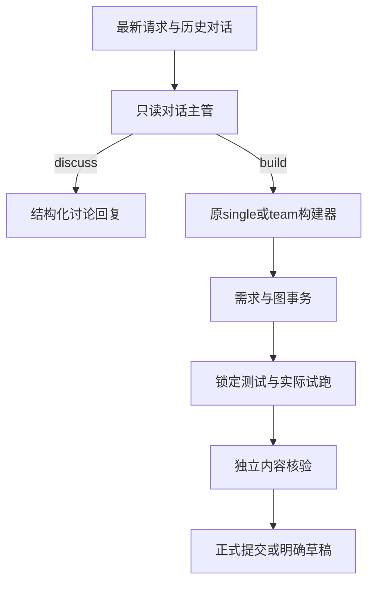

# 只读对话主管与构建交接

2026-10-03｜dev.80，dev.83补充｜已实现并完成本地验证，dev.83截图原句真实MiniMax复验通过｜[主文档](../README.md)

## 问题与依据

用户要求从agent架构解决“请先讨论乘客、旅程阶段与互动方式”却编排失败的问题。此前非问候消息直接进入构建团队；主管提示、工具与完成判定只有图构建出口。真实worker配合合成SDK正常结束纯文本回复时，宿主仍因没有brief/候选/submit而返回错误。原主管只收到最新prompt，未收到请求中的conversation_history；子角色虽然收到用户历史，不能补救主管入口的上下文缺失。

截图原始请求只在追加日志留下HTTP 200（SSE连接成功），没有对应终止诊断持久记录。因此已确认的是此类讨论必然缺少合法完成路径，不据此断言截图当时没有同时发生上游错误。

## 决策

沿用原固定版本Hermes SDK、配置模型与single/team构建器，在worker内部增加独立、只读的conversation_supervisor。

- 入口只暴露 `oakegde_route_turn`。无改图、委派、试跑或保存工具；读取的是宿主提供的项目快照。模型结合最新消息、用户与助手历史判断discuss/build，不增加旅程/儿童等关键词特判。
- discuss必须提交非空reply；宿主交付chat_reply，`status=discussion`、`can_apply=false`、`runtime_verified=false`。项目节点、连线与metadata保持原样；即使save_on_success=true也不保存。
- build只能交接，不能用一段“已完成”回复代替图提交。收到有效交接前不创建构建团队；普通文本结束或非法工具面不能触发隐式构建/降级。
- 对话主管和构建主管均收到结构化的最新请求、user/assistant历史及当前项目；历史角色是数据，不提升为system指令。助手的建议不自动等于用户批准。
- 两阶段有独立工具面，宿主检查phase迁移与discussion响应。原图检查、锁定输入/断言、最多三次实际试跑、内容核验、同版本证据要求不变。
- dev.83补充：SDK正常结束但未交付时，提供工具契约反馈，携带本轮SDK历史继续只读讨论；不直接采信普通文字。失败/部分响应/中断不作此类续作，入口累计最多3次completion（包含字段重试），预算耗尽仍失败；诊断记录真实交付工具尝试与拒绝。
- 入口最多3轮，和原编排团队共同消耗40次completion/720秒，宿主总期限780秒不变。合法工具交付后interrupt停止模型总结循环，和既有子角色交付模式一致；report用delivery_complete区分这种主动结束。
- MiniMax-M3官方绑定沿用已使用的指定成果工具机制；其他提供商不推定支持强制tool_choice。
- 失败文案由白名单诊断生成，说明停止阶段和已知原因，不回显模型原文、推理或密钥，不将未知原因补成限流/余额问题。

## 范围与代价

本轮作用于当前配置的Hermes分支；旧bounded引擎及既有显式问候快捷回复保持。构建多一次入口调用；讨论只需入口，无四角色构建成本。仍没有跨请求的服务端持久对话数据库，继续使用前端传来的历史；不承诺模型永不误判意图。

[验收与限制](../product/releases/2.8.0-dev.80/ACCEPTANCE.md)：本地合成SDK、真实固定SDK+localhost协议夹具、后端与前端回归通过。外部MiniMax调用被自动审批拒绝，已向用户询问授权；未授权前不执行，也不将本地夹具算作模型语义验收。

2026-10-03 dev.83续验：用户要求重新发送后，真实MiniMax首次普通文字结束，经契约提示在第2次调用完成结构化讨论交付。外发仅截图原句及必要工具说明，不含已有项目或历史。详见[dev.83验收](../product/releases/2.8.0-dev.83/ACCEPTANCE.md)；上文dev.80未授权为当时历史状态。

dev.102（2026-10-08）用户明确授权：共享编排预算由24次/480秒放宽到40次/720秒，宿主540→780秒。此前版本数字仅为历史证据；当前期限审计、真实结果及限制见[本轮验收](../product/releases/2.8.0-dev.102/ACCEPTANCE.md)。图执行与独立内容核验的局部预算保持。

预算收尾沿用完整trial及独立内容核验；核验不可用沿用原重试、失败保持incomplete_result。host_finalized只标记宿主来源，不能代替can_apply；执行/核验调用另计。仅剩余宿主时间≥245秒时可启动，低于此值报告跳过。无有效计划不自造测试。

dev.103（2026-10-08）：每次编排API请求单独默认150秒，来自EngineConfig.api_call_timeout_seconds，由worker profile同时配置custom/anthropic；取代dev.102单请求720秒。整轮40次/720秒、宿主780秒保持。正常SDK重试计入编排次数，超时快照回传最后revision及计数，不改变本ADR架构。
