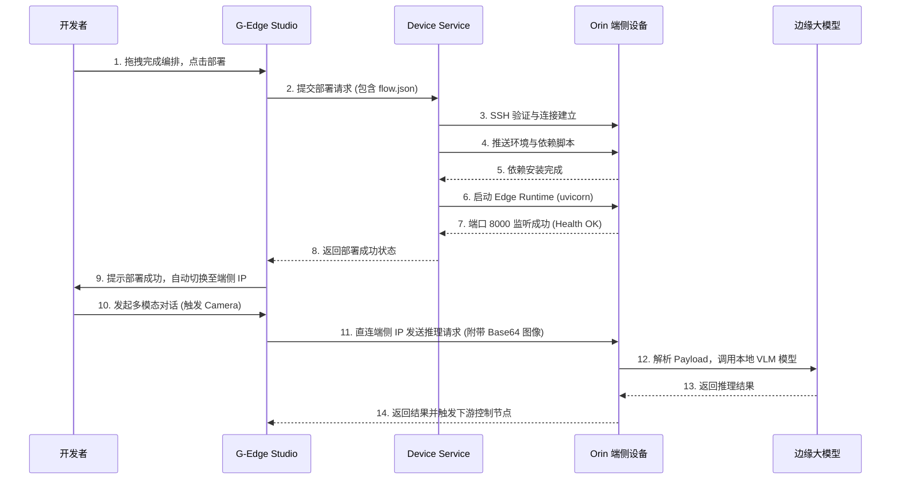

# G-Edge 端侧智能体一体化开发平台 - 系统架构设计文档 (V2.0 工程化重构版)

## 1. 架构设计原则
为支持未来 3 年业务扩展，系统全面向**高内聚、低耦合的微服务化分层架构**演进。
*   **表现层 (Presentation Layer)**：React + Vite，负责可视化编排、监控展示，通过 Gateway 聚合接口交互。
*   **网关层 (API Gateway)**：负责鉴权、限流、路由分发。
*   **业务逻辑层 (Business Layer)**：
    *   `Orchestration Service` (编排服务)：负责处理 DAG 逻辑解析与下发。
    *   `Device Management Service` (设备管理服务)：负责边缘设备的连接、状态监控与远程部署。
    *   `Agent Core Service` (智能体核心服务)：负责大模型调度、工具调用与记忆管理。
*   **数据访问层 (Data Access Layer)**：
    *   结构化数据：PostgreSQL (取代 SQLite) 用于持久化项目、设备状态。
    *   向量数据：ChromaDB/Milvus 用于 RAG 和长短期记忆。
    *   缓存与消息：Redis 用于状态缓存与设备通信状态管理。

## 2. 系统架构图 (类图与组件图)

```mermaid
graph TD
    %% 表现层
    subgraph Frontend [表现层 - G-Edge Studio]
        UI[可视化 UI 组件]
        Canvas[React Flow 编排画布]
        Monitor[3D & 监控面板]
    end

    %% 网关层
    Gateway[API Gateway / Nginx]
    Frontend -->|HTTP/WebSocket| Gateway

    %% 业务逻辑层
    subgraph BusinessLogic [业务逻辑层 - 微服务群]
        OrchService[Orchestration Service\n(编排与解析)]
        DeviceService[Device Management\n(设备与部署)]
        AgentService[Agent Core Service\n(推理与工具调度)]
    end
    
    Gateway --> OrchService
    Gateway --> DeviceService
    Gateway --> AgentService

    %% 数据访问层
    subgraph DataAccess [数据访问层]
        PG[(PostgreSQL\n元数据)]
        Redis[(Redis\n缓存&队列)]
        VectorDB[(Vector DB\n知识库/记忆)]
    end

    OrchService --> PG
    DeviceService --> PG
    DeviceService --> Redis
    AgentService --> VectorDB
    AgentService --> Redis

    %% 端侧引擎层
    subgraph EdgeDevice [端侧引擎层 - NVIDIA Orin / AI Box]
        EdgeDaemon[Edge Daemon\n(生命周期管理)]
        InferenceEngine[Inference Engine\n(Ollama/TensorRT)]
        Sensors[HAL Sensors\n(Camera/CAN)]
    end

    DeviceService <-->|SSH / gRPC| EdgeDaemon
    AgentService <-->|HTTP| InferenceEngine
    EdgeDaemon --> Sensors
```

## 3. 核心业务时序图 (端侧部署与推理流)



## 4. 目录结构规范化建议 (针对 Python Backend)

```text
backend/
├── app/
│   ├── api/            # 控制器层 (路由定义与入参校验)
│   ├── core/           # 核心配置 (Config, Security, Logging)
│   ├── models/         # 数据模型层 (SQLAlchemy / Pydantic)
│   ├── schemas/        # DTO (Data Transfer Objects)
│   ├── services/       # 业务逻辑层 (具体的业务处理)
│   ├── utils/          # 公共工具类 (HTTP Client, SSH Helper)
│   └── main.py         # 应用入口
├── tests/              # 单元测试与集成测试
├── alembic/            # 数据库迁移脚本
├── Dockerfile          # 容器化构建文件
├── requirements.txt    # 依赖管理
└── pyproject.toml      # 工程配置 (Ruff/Black/Pytest)
```
