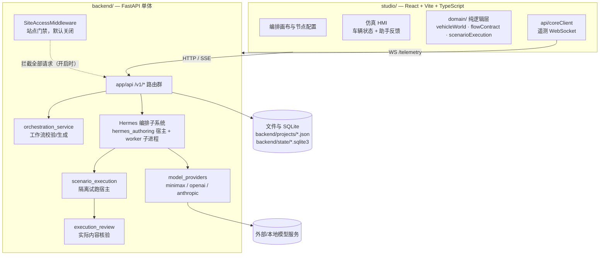
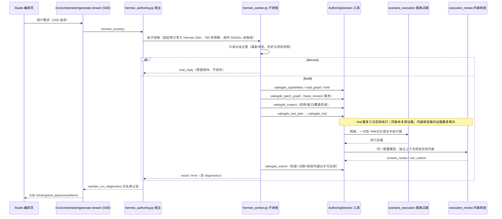

# OAKEgde Studio 当前实现架构（现状描述）

- **目的**：按代码与配置如实描述当前系统的组件、数据流和边界，作为后续设计与评审的共同基线。
- **状态**：当前规范（描述现状，不构成扩展承诺）。
- **维护日期**：2026-10-03。原dev.74架构快照；本次仅将第4节更新至dev.80对话入口，其他领域未重新全面审计。dev.79/80为未提交工作区，未发布。
- **适用范围**：智能座舱场景编排 MVP（产品边界见 [CONTEXT.md](../../CONTEXT.md) 与 ADR 0001）。
- **主文档返回**：[docs/README.md](../README.md)。
- **与旧文档关系**：[01_System_Architecture.md](01_System_Architecture.md) 是 2026-07 的愿景版微服务规划（PostgreSQL、API 网关、Orin 端侧部署），属历史参考；本文取而代之描述现状，不声称那些组件已实现。

## 1. 总体组件视图

当前实际运行的是「一个前端 + 一个 Python 后端」的工作台形态，不是微服务群：

## 2. 前端 studio/

- 三阶段工作台：编排、仿真、部署（导航约定见 CONTEXT.md「项目操作与导航整合」）。
- `src/domain/` 承载与 UI 解耦的领域逻辑：`vehicleWorld.ts`（仿真世界共享车辆状态）、`flowContract.ts`/`flowLoops.ts`（流程契约）、`scenarioExecution.ts`/`scenarioSession.ts`（场景运行会话）、`durableFlow.ts`（流程持久化格式）。
- `src/components/` 按区域组织：`nodes`（画布节点）、`hmi-tesla`/`hmi-widgets`（仿真 HMI，主体验入口，见 ADR 0004）、`pages`、`spatial`（3D 车模）等。
- `src/api/coreClient.ts` 连接后端 `/telemetry/dag`、`/telemetry/physics` WebSocket 收取遥测。原 `src/api/llm.ts`（场景工程助手前端直连中继的临时实现）已于 2026-09-30 删除（未提交，见第 10 节）。
- 站点访问前门：`SiteAccessGate.tsx`，探测后端 `/v1/access/session` 的 `required` 字段，门禁关闭时自动解锁（见 ADR 0007）。

## 3. 后端 backend/

FastAPI 单体，两个入口适应不同部署：

- `main.py`：全量应用，挂载全部 `/v1/*` 路由（编排、执行检查点、能力库、模型、项目、记忆、MCP、推理、部署、边缘 provisioning、系统、音频等）及 `/telemetry` WebSocket。
- `main_host_lite.py`：轻量宿主，保留编排/部署/项目/SDK 等 API，但不强依赖 torch/transformers 本地推理栈；本地推理端点在依赖可用时才启用。
- `deploy/windows/server.py`：Windows 部署入口，同样基于 host-lite 形态。

代码分层（与现状一致，非愿景）：`app/api`（路由）、`app/services`（业务逻辑，约 40 个服务模块）、`app/schemas`（Pydantic DTO）、`app/core`（配置/引擎/门禁/记忆）、`app/agents`（编排 worker 及其系统提示词）。

## 4. Hermes 编排子系统（自主构图）

自然语言需求 → 可运行能力图的核心链路。多角色分工与契约诊断的决策细节见 [ADR 0005](<../adr/0005-multi-role-orchestration.md) 与 [ADR 0006](../adr/0006-orchestration-contract-diagnostics.md>)，本节只画现状数据流：

要点：

- **对话主管**（dev.80，[ADR 0009](../adr/0009-conversation-intake.md)）：只暴露oakegde_route_turn；讨论无需图提交即可正常完成；有效build交接才创建下述single/team构建器。两个主管均获得完整请求上下文，讨论不修改项目；本地回归及真实SDK+本机HTTP夹具通过，真实MiniMax语义复验待授权。

- **single / team 两种模式**：`agent_mode` 由 API 字段指定，省略时用服务端配置。注意两层默认值不同：代码 `EngineConfig` 缺省为 `single`，当前部署配置 `.demo-runtime/orchestration-engine.json` 为 `team`（ADR 0005「模式选择」已澄清）。
- **team 模式**（`authoring_team.py`）：主管 + 需求员、状态/路径设计员、节点搭建员、测试员四个角色，各自独立 AIAgent 上下文、同一配置模型。子角色只读能力并经 `oakegde_deliver_<role>` 提交版本化成果；只有主管能应用成果、驱动图事务和试跑。委派有依赖前置（需求先于其余、搭建需设计成果、测试需已有节点），首版串行。
- **工具契约严格**（`authoring_session.py`）：8 个 `oakegde_*` 工具，Contract 禁止额外字段；多余字段硬拒绝并给字段名级修复提示（不回显参数值）；`flowVersion` 仅 `"2"`/`2.0` 由宿主归一化为整数 2 并在 `normalized_arguments` 告知（ADR 0006）。
- **诊断出边界前必须过白名单**：`authoring_diagnostics.sanitize_run_diagnostics` 过滤 worker 诊断；宿主 780 秒超时返回 `termination=host_timeout` 的部分诊断。新增诊断字段必须同步加入白名单，否则被静默丢弃。
- **预算**：对话入口与单/多模式合计共用 40 次编排 completion 与 720 秒编排期限；宿主 780 秒取消整组进程。

## 5. 场景执行与内容核验

- `scenario_execution.py`：在隔离、一次性的 HMI/记忆宿主中运行生产图。子环境不获得密钥，能力接口不提供任意 HTTP 访问；只有显式绑定的 API 模型可由父进程调用；表达式节点走共享数据求值器。这不是设备执行器。
- `execution_review.py`：运行通过后，用同一配置模型的独立上下文核验实际内容（`content_review`），每份执行证据最多两次核验；`runtime_verified` 与 `content_review` 都通过才 `can_submit`。核验缺失或服务错误不允许自行声称通过。
- 最终验收沿用既有图执行器、锁定输入/断言与内容核验；分工编排本身不作为质量证明（ADR 0005）。

## 6. 模型接入

- `model_providers.py`：服务端持有的编排提供商（minimax / openai / anthropic），密钥来自 `.demo-runtime/model-providers.json` 或环境变量，**不进入项目 JSON**。端点 `/v1/orchestration/providers` 查询与配置。
- 目录与本地能力：`qualcomm_catalog.py`（高通模型目录快照）、`model_service.py`（`backend/state/models.json` 注册表）、`opensparx_service.py`（本地多模态）、`audio.py`（本地语音识别）。云端/端侧边界的维护依据见 docs/README 台账「模型分工与接入」。

## 7. 站点访问门禁

`SiteAccessMiddleware`（`app/core/site_access.py`）+ 前端 `SiteAccessGate` 完整保留、**默认关闭**；设 `OAKEGDE_SITE_ACCESS=1` 恢复密钥校验、会话 Cookie、登录限流与来源白名单。关闭时所有请求直通，WebSocket 与 Origin 白名单检查一并跳过。安全影响与决策细节见 [ADR 0007](../adr/0007-site-access-default-off.md)。

## 8. 数据与存储

| 数据 | 位置 | 说明 |
| --- | --- | --- |
| 项目（场景图） | `backend/projects/*.json` | 业务标题、节点实例、模型绑定；不含 API 密钥 |
| 执行检查点 | `backend/state/executions.sqlite3` | 试跑与执行证据 |
| 能力库 | `backend/state/capability-library.sqlite3` | 能力节点目录 |
| 模型注册表 | `backend/state/models.json` | 本地登记模型 |
| 服务端配置 | `.demo-runtime/model-providers.json`、`orchestration-engine.json` | 提供商密钥引用与编排模式部署配置 |
| 编排运行证据 | `runs/<场景>-<模式>/`（评测时） | summary.json / events.jsonl / tools.jsonl；失败诊断在 `summary.json` 的 `error.diagnostics` |

当前没有 PostgreSQL/Redis/向量库；01 文档中的数据层规划未实现。

## 9. 仓库内其他组件与当前主链路的关系

以下组件存在于仓库，但**不在当前智能座舱 MVP 的运行主链路上**（按代码引用关系与文档登记判断，标注为推断）：

- `core/`（Rust 微内核 g-edge-core 2.0.0：engine/event_bus/healing/telemetry）：历史端侧平台代码，`studio/src/api/coreClient.ts` 注释仍提及「Rust Microkernel / Legacy Python Backend」，实际遥测由 Python 后端 `/telemetry` 提供。
- `runtime/sa8397`、`examples/sa8397`、`hal/`：SA8397 端侧交付资料，启动与验收见 docs/devops 对应记录，按目标环境单独验收。
- `deploy/production/`（Caddy + docker-compose）：生产部署样例；当前本机与 Windows 部署路径见 docs/devops。
- `pipelines/`：空目录。

端侧接入、传感器级物理仿真属后续能力，不阻塞当前 MVP（ADR 0001/0002）。

## 10. 已知不一致与待澄清

- CONTEXT.md 旧表述「服务端默认 team」指部署配置，代码缺省为 single——已在 ADR 0005 澄清，本文第 4 节按澄清后口径描述。
- 原 `studio/src/api/llm.ts` 曾硬编码第三方 LLM 中继密钥（`sk-`，自基线提交起在 Git 历史中），与服务端集中管理密钥（第 6 节）的架构意图冲突。处置记录（2026-09-30）：用户确认删除该文件，claude-code 已删（未提交，`git status` 显示 D，删除前确认无引用，删除后 `tsc --noEmit` 与 Vite 构建通过）；用户决定旧 key 不轮换，推送 GitHub 未成功、暴露面暂限本机，但密钥仍在本地 Git 历史中，下次 push 前必须先在 scratch 克隆中用 filter-repo 清理历史（squash 或改写），用户已确认此为推送前置阻断项；历史清理与推送由 claude-code 执行，推送前需再次向用户确认。
- 本描述基于 2.8.0-dev.74 未提交工作区；其中 dev.68–dev.74 各轮功能均未提交、未发布，恢复能力以工作区为准。

## 项目持久化（dev.89）

WorkspacePage接收FlowCanvas持久化图变化，把对话/配置/结果交给ProjectAutosave；同项目串行合并，发送前记录浏览器未同步快照。App启动恢复未同步工作区；项目服务检查版本并原子替换。成功后清理对应恢复记录。此逻辑独立于模型Worker：上图“讨论原图保持、不保存”描述Worker不直接写项目，讨论消息仍由前端自动保存。不保证请求跨浏览器关闭续跑。详见[dev.89验收](../product/releases/2.8.0-dev.89/ACCEPTANCE.md)。

dev.102（2026-10-08）用户明确授权：共享编排预算由24次/480秒放宽到40次/720秒，宿主540→780秒。此前版本数字仅为历史证据；当前期限审计、真实结果及限制见[本轮验收](../product/releases/2.8.0-dev.102/ACCEPTANCE.md)。图执行与独立内容核验的局部预算保持。
