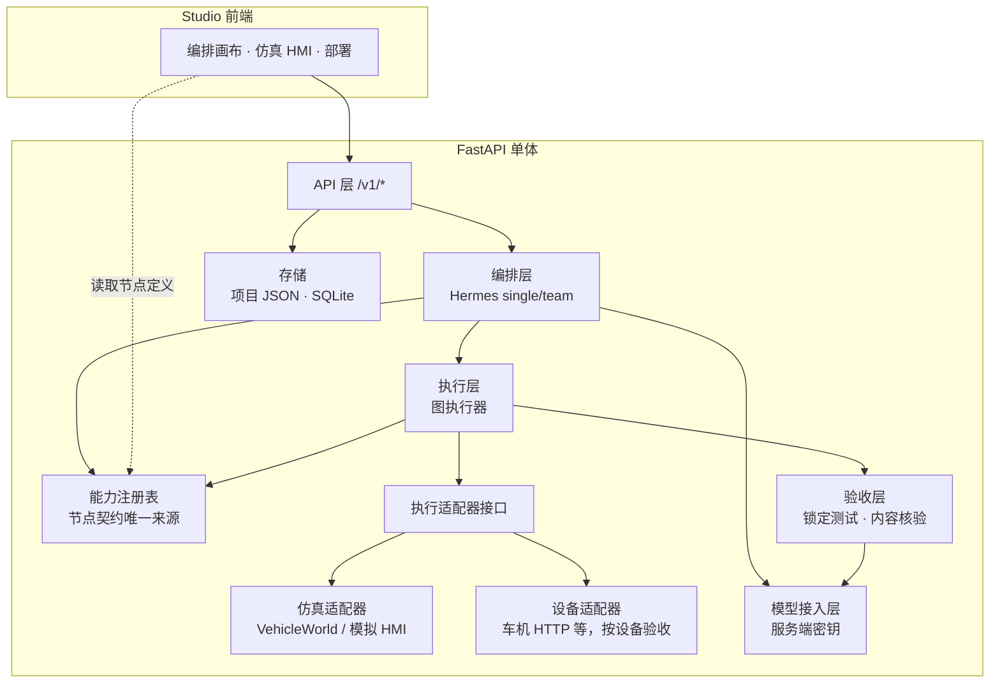

# OAKEgde Studio 目标架构（MVP 阶段）

dev.111本轮局部实施：按用户确认把bounded的合并理解/选择拆为understand、逐需求本地检索、select；原文与改写共同支撑选择，阈值/每意图Top-K代替候选字符裁剪，完整注册目录仍保障可见性。不新增服务或改变能力执行契约，正常路径增加一次选择请求，总8次保持。此轮不推进GraphPatch或Hermes适配；[需求](../product/releases/2.8.0-dev.111/PRD.md)、[实际验证](../product/releases/2.8.0-dev.111/ACCEPTANCE.md)。

- **目的**：在现状架构基础上，明确接下来按什么结构演进：哪些保持、哪些要补、哪些明确不做。
- **状态**：当前规范（用户 2026-09-30 确认第 6 节全部事项）。描述目标结构与演进顺序，不代表已实现；实现与验收按各迭代记录。
- **维护日期**：2026-09-30。主依据：[02 现状架构](<02_Current_Implementation_Architecture.md)、ADR 0001–0007、[ADR 0008](../adr/0008-target-architecture-and-device-access.md)、[NODE_CONTRACTS.md](../product/NODE_CONTRACTS.md>) 第 9 节、AGENTS.md「通用能力优先」。
- **主文档返回**：[docs/README.md](../README.md)。

## 1. 总原则

1. **保持单体，边界靠接口而非进程**。MVP 阶段继续 Studio + FastAPI 单体 + Hermes 编排子进程。模块边界用 Python 接口和契约文件划清，不拆微服务、不引入网关或消息队列。01 文档的微服务规划不作为目标。
2. **能力契约是唯一事实来源**。编排、画布、试跑、核验都读取同一份机器可读的节点能力注册表，不各自维护节点定义。
3. **仿真与真实设备走同一执行契约**。节点只调用执行接口，由适配器决定是仿真还是真实设备，结果必须标明 `source: simulation|device`。
4. **验收门禁不因架构演进放松**。图执行、锁定测试、内容核验仍是能否应用的唯一依据。
5. **密钥只在服务端**。前端和项目 JSON 不持有任何提供商密钥；非本机部署必须开启站点门禁（ADR 0007）。

## 2. 目标分层

和现状相比，新增的只有两处结构：**能力注册表**成为前后端共用的单一来源，**执行适配器接口**把仿真和真实设备隔开。其余层已经存在，保持不动。

## 3. 需要补齐的两处结构

### 3.1 能力注册表

- 现状：运行节点定义已经是同一份 JSON 的两份副本：`studio/src/data/nodeCapabilities.json`（前端编译期 import）和 `backend/app/services/node_capabilities.json`（后端 `node_capability_service` 读取），2026-09-30 比对内容一致。一致性只靠后端测试 `test_shared_catalog_has_image_input` 比对两份文件；前端文件不存在时该检查会跳过。能力库 SQLite 与前端 `capabilityPresentation/capabilityTree` 处理的是导入能力资料，另成一条链路。NODE_CONTRACTS 的 14 个目标节点仍是文档定义，和 16 种运行节点靠文档对照表映射。
- 第一步（dev.76 已完成）：`backend/app/services/node_capabilities.json` 为唯一来源；studio 副本由 `scripts/sync_node_capabilities.py` 生成并提交（studio 生产构建上下文不含 backend，不能直接引用），后端测试在副本缺失或漂移时失败。
- 目标：按 NODE_CONTRACTS 第 9 节，把节点定义转成机器可读的注册表（schema、实现绑定、依赖、失败出口、证据引用），前后端和 Hermes 工具（`oakegde_capabilities`）都读取它。
- 约束：缺少能力、权限或输入时，编排停在草案状态并标注缺口（ADR 0005 已有此规则），不能用文字冒充执行。

### 3.2 执行适配器接口

- 现状：`car_control` 主要是车窗仿真；仓库里已有车机 HTTP API 规格（`Atomic_service_car_control_http_api.md`，`http://<device-ip>:8080`），只作为模板出现在编排服务里，没有接成设备适配器。devops 部署日志中 8397 上的车控节点返回 `car control placeholder mode`，从未调通真实接口。
- 目标：`device.act` 这类节点只调用一个执行接口，输入输出按 NODE_CONTRACTS N12 定义。后端可插拔：仿真适配器、mock 适配器、设备适配器实现同一接口，不把某一条具体 HTTP 路径写死为架构。
- 结果来源：`source: simulation | mock | device`。`device` 结果还要注明验证深度（仅接口回执，或执行机构实测）。
- 约束：设备适配器必须单独验收（回执、实测、超时先查状态再重试）；仿真或 mock 通过不能写成设备可用。

### 3.3 8397 实测（2026-09-30，adb 只读检查）

- 设备：`zeekr_dhu_sa8397`，Android 16（API 36），arm64-v8a，userdebug，adb 以 shell 用户连接。
- 8080 无监听，`127.0.0.1:8080/api/vehicle/signals` 连接失败。即：HTTP 车控规格对应的服务不在这台设备上。
- `com.zeekr.ap.http.server`（`/system/app/HttpdShareServer`）未运行，从名称看是文件共享类服务，未启动验证。
- 厂商车控相关应用存在（如 `com.zeekr.carcontrol.brower`、`com.zeekrlife.soa`），推断车控经厂商 SOA 或 Android Car API 提供，没有接口文档。
- `/data/local/tmp` 下无既往 `cyber_edge_agent` 运行目录。
- 检查工具：官方 Android platform-tools，放在 Hermes scratch 目录，未安装到系统；未在设备上启动或修改任何东西。

### 3.4 实车接入的三层验收

用户确认实车接入纳入 MVP（2026-09-30）。当前只有 8397，没有台架，按三层分开验收：

| 层 | 内容 | MVP 内 | 依赖 |
| --- | --- | --- | --- |
| 1 端侧上板 | 编排图和端侧模型在 8397 上运行，与主机结果对照 | 是，完整验收 | 已有 8397、`host_lite_edge_service` 打包链路、`runtime/sa8397` |
| 2 车控接口 | 设备适配器调用车控接口，验证请求格式、回执与失败语义 | 是；当前只做 mock，按 HTTP 规格验证适配器逻辑 | 无车控服务 APK（用户确认）；真实接口待 APK 或厂商 SOA 文档 |
| 3 执行机构 | 座椅、车窗等真实动作与状态回读 | 否 | 台架或整车 |

## 4. 保持不变

- Hermes 编排子系统的宿主/worker 子进程结构、预算和诊断白名单（ADR 0005、0006）。
- 隔离试跑：子环境不拿密钥，不提供任意 HTTP 访问。
- HMI 作为体验入口、VehicleWorld 作为状态源（ADR 0004）。
- 存储继续使用项目 JSON 和 SQLite。

## 5. 明确不做（MVP 阶段）

- 拆分微服务，引入 PostgreSQL、Redis、向量库或 API 网关。
- 让 `core/` Rust 微内核重新进入主链路。
- 传感器级物理仿真；无人机、机器人等暂缓领域（ADR 0001、0002）。
- 为单个场景加特判节点或固定拓扑（AGENTS.md「通用能力优先」）。

## 6. 已确认决策（2026-09-30）

| # | 问题 | 结论 |
| --- | --- | --- |
| 1 | 目标架构是否保持单体、不拆微服务 | 保持单体 |
| 2 | 能力注册表是否先于设备接入 | 先做注册表，再做设备适配器 |
| 3 | 实车接入是否纳入 MVP | 纳入，按 3.4 三层验收 |
| 4 | `core/`、`runtime/sa8397`、`deploy/production` 的定位 | `core/` 冻结为历史参考；`sa8397` 为端侧部署与实车接入目标；`deploy/production` 为服务器部署模板，使用时必须开启站点门禁 |
| 5 | 第 2 层车控接口的来源 | 用户确认无车控服务 APK（2026-09-30）：MVP 先做 mock 设备适配器，结果标 `source: mock`，不得写成实车已执行；拿到 APK、厂商 SOA 文档或台架后另行验收 |

以上决策登记为 [ADR 0008](../adr/0008-target-architecture-and-device-access.md)。

## 7. 演进顺序

编排成本与可靠性专题主依据见[整体优化方案](../product/ORCHESTRATION_OPTIMIZATION.md)（维护2026-10-14）。dev.108形成设计与历史真实失败证据；dev.109已在新分支接入M1/M2任务能力视图、阶段上下文和计量/证据，采用单体内存索引，不新增服务或改变SDK。第一批离线结果见[dev.109验收](../product/releases/2.8.0-dev.109/ACCEPTANCE.md)，增量修复与真实质量/成本仍待验收。当前真实引擎bounded，不将本页历史Hermes示意图视为当前默认引擎。

1. 能力注册表：前后端 `nodeCapabilities.json` 合并为单一来源。
2. 执行适配器接口 + mock 车控适配器，结果标 `source`。
3. 8397 端侧上板，与主机结果对照。
4. 取得车控服务 APK、厂商 SOA 文档或台架后，补真实设备适配器并单独验收。
