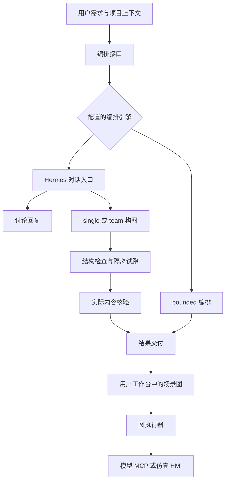

# 核心概念与运行链路

目的：理解界面中的对象与运行状态，避免将资料入库、构图成功、执行成功和实际设备动作混为一谈。状态：当前源码阅读指南。维护日期：2026-10-14。主依据：[CONTEXT](../../CONTEXT.md)、[当前架构](../architecture/02_Current_Implementation_Architecture.md)、下文源码。返回[开发者文档](README.md)与[项目主文档](../README.md)。

## 项目与场景图

项目是保存单位，包含 ID、名称、节点 `nodes`、连线 `edges` 和 `meta`。场景描述用户想完成的体验，场景图表达具体执行路径。项目可以包含讨论和未完成图，保存成功不表示图可执行。

能力描述通用职责，例如输入、模型理解、条件判断或工具调用。节点实例则携带这个场景的配置，例如模型、提示词和输入绑定。阶段容器用于组织节点，本身不执行动作，也不能当作产生输出的节点连接。

能力资料入库只是保存说明；即使绑定了 MCP 工具，也要分别检查登记是否有效、工具是否可连接、业务是否经过验证。目录中的模型介绍同样不代表该模型已经部署。

## 共创与执行是两条链路

dev.111当前实现：bounded按 `understand → 本地逐需求检索 → select → 加载选中契约 → build/repair/review` 推进。理解只看原文、用户历史与项目摘要，不看能力目录；输出brief和逐需求queries，纯禁止/保持约束用null，不作正向检索。select获得改写及原始description/source_quote、全部原文、分需求候选和完整目录，不能修改已锁定意图。相对RRF门槛0.35/每意图普通Top-K32取代6000字符预算，强制ID/已有引用单独保留；分需求合并不再全局截K。每意图局部分数只在query_sources中保留，不构造跨意图全局分；来源写入report/project.meta。相对分不是正确概率，目录可见性不证明模型正确选择。正常新协议比旧合并协议增加一次select调用，总8次不变；自定义旧completion兼容路径明示。具体状态见[验收](../product/releases/2.8.0-dev.111/ACCEPTANCE.md)。下面dev.109/110为历史行为。

dev.110可用性补充：用户明确缺少一个必要能力即任务失败，完整召回目标99.9%。理解阶段始终提供完整已登记能力短目录，BM25＋embedding只给优先顺序；6000字符预算只限制优先候选，不隐藏目录身份。全部身份可见不代表全部被授权，也不代表模型一定选对。原27/30优先候选完整率为90%，此前95.39%平均Recall是排序诊断；新完整目录回归60/60可见，不证明总体99.9%或生成图通过。实际结果见[最新验收口径](../product/releases/2.8.0-dev.110/ACCEPTANCE.md#用户最新可用性门槛与补充当前口径)。

dev.110（2026-10-14）：工具索引按canonical ID分条，BM25处理词项与标识符，本地BGE处理语义改写，宿主融合两个排名。工具、动作、控件和MCP绑定各有自己的静态语义文档；权限/配置/来源是独立事实，向量相近不能授予权限。精确ID与已有项目引用保留，候选只提供发现线索，详情仍按选择载入。检索在工作线程执行，避免本地模型加载阻塞异步编排流；真实模型与检索测评状态见[本轮验收](../product/releases/2.8.0-dev.110/ACCEPTANCE.md)。

dev.109（2026-10-14）：bounded 理解阶段由宿主内存FTS5/BM25召回候选，提供19类节点概览，在同次PlanningResult返回需求与能力映射；构图只加载已选节点/动作/控件/工具的必需契约。原始用户历史全部保留，不再只取末8条；模型摘要不能替代原文。未知用途、未加载详情与漏选归selection_incomplete，不等同于平台缺能力。空ID补载只扩大静态契约与短索引，不发现全部MCP服务。

每请求最多8次编排调用，理解最多2次、构图/补载合计3次、审查最多3次，实际POST前扣额；图内推理维持独立预算。调用方计划锁定；生产路径要求真实试跑通过且有实际步骤，内容审查检查本步骤真实证据编号。明确设备/MCP来源不能被仿真或静态文字覆盖。旧不可新建类型仅保持原有同ID/类型实例。实现/验证与未完成项见[dev.109验收](../product/releases/2.8.0-dev.109/ACCEPTANCE.md)。

当前修复仍输出完整WorkflowDraft，M3的GraphPatch接线、配置/适配器版本证据身份与M4 Hermes兼容尚未实施。现有大图在首次构图保留完整配置以保护无关字段；不能把这一阶段称为已完成局部增量编辑。

2026-10-13现状核对：当前真实引擎为bounded，理解和构图提供完整节点目录，修复生成完整替换结果；尚无任务能力筛选。后续设计见[编排整体优化方案](../product/ORCHESTRATION_OPTIMIZATION.md)，其中按需目录、阶段上下文与patch均是计划，不是当前接口行为。源码与证据见[dev.108验收](../product/releases/2.8.0-dev.108/ACCEPTANCE.md)。

共创把用户需求变成讨论结果或场景图；执行使用图中的节点处理具体输入。它们会调用不同服务，不能用一次共创成功替代场景执行验收。



Hermes 的只读对话入口处理讨论或交接构建。`single` 与 `team` 都受宿主检查和既有执行验收约束；多角色本身不是质量证明。引擎由服务端配置，不能从前端显示的模型名称推断使用了哪个引擎。

构建结果可能是 `chat_reply`，也可能包含项目、验证结果和报告。客户端应按返回字段判断，不应在收到任意文字时清空或替换画布。实际逻辑见 [scenario_builder](../../backend/app/services/scenario_builder.py)、[Hermes 宿主](../../backend/app/services/hermes_authoring.py)、[工作区页面](../../studio/src/components/pages/WorkspacePage.tsx)。

dev.108的bounded恢复保留原始请求目标，模型归纳目标另存为`proposed_goal`。若下一轮repair结构/覆盖损坏，保留最近有有效字段和原需求ID覆盖的草稿，并以`candidate_attempt`标注来源；它不是验证通过的旧成果，仍不可应用/执行，旧试跑不冒充本轮成功。有blocking questions时，构图失败仍返回`needs_input`，可以没有图或带全designOnly草稿。

bounded复用Hermes的计划预检和受限修订：无效AI计划不提前锁定；有效计划可按既有状态、等义类型、合法路径与同图waiting证据纠错，不能更改输入或真实预期，调用方计划完全锁定。图或计划修改使旧运行证据失效，试跑预算不重置。普通车控继续只接收actions；固定车窗节点不能把JSON分类结果直接当动作授权。

## 节点如何获得数据

通用绑定用 `{"$ref":"input.text"}` 等对象表达，保留被引用值的类型。输入来源包括 `input`、`event`、`state`、`outputs`。例如 MCP 参数：

```json
{
  "tool_id": "mcp",
  "serverId": "catalog-fetch",
  "toolName": "fetch",
  "arguments": {"url": {"$ref": "input.text"}}
}
```

这是节点 `data` 的片段，不是完整可导入项目。它要求当前上游输入确实是一条 URL。工具后模型的 `input.text` 通常是工具结果，不能继续将它当成最初用户输入；需要更早节点结果时使用 `outputs.<节点ID>...`。

绑定路径只允许点分隔标识符，不支持数组下标或原型字段；节点 ID 用于绑定时也需满足路径规则。多条输入汇合要显式声明 `joinMode`，区分等待全部 `all` 和任一分支 `any`。详见 [flowContract.ts](../../studio/src/domain/flowContract.ts) 与[节点契约](../product/NODE_CONTRACTS.md)。

## 如何判断成功

| 状态或证据 | 能证明什么 | 不能证明什么 |
| --- | --- | --- |
| 图结构检查通过 | 节点、配置、连线符合所检查契约 | 模型会给出正确答案 |
| 模拟回归通过 | 固定输入与模拟响应下行为符合预期 | 远端模型或工具真实可用 |
| 真实模型试跑通过 | 指定模型、输入、配置的本次运行成功 | 任意输入都可靠 |
| HMI 状态正确 | 仿真控件与场景链路正确更新 | 实车执行了动作 |
| MCP 返回成功 | 工具报告的本次调用结果 | 外部动作一定可重试或具备事务 |
| 保存返回成功 | 本次快照已获服务端确认 | 新编辑、其他标签页修改也已保存 |

工具错误走失败路径。兜底提示可以改善体验，但不能将失败重新标为业务成功。结果中的 `data` 可能为空，文本存在于 `text` 或 `content`；不要凭空补出结构化数据。

## 保存与执行恢复

项目自动保存维护图和对话快照，前端先保留本地恢复副本，再串行写服务端；更新使用 `expected_updated_at` 检查冲突。遇到 409 应保留副本并处理冲突，不能降级为无条件覆盖。实现见 [projectAutosave.ts](../../studio/src/domain/projectAutosave.ts)。

执行恢复使用另一套检查点与租约，保存流程状态及仿真状态。`running` 表示上轮仍在运行或中断，不能自动重放外部动作。项目保存、执行检查点和第三方工具幂等是不同问题。实现见 [durableFlow.ts](../../studio/src/domain/durableFlow.ts)、[执行存储](../../backend/app/services/execution_store.py)。


## dev.103：测试计划与中断恢复（2026-10-08）

测试步骤通常省略status，仍按not_failed和原业务断言验证；明确要求完成/等待时才填。AI计划可单独修改/删除status，其他字段继续按dev.101受限规则，调用方计划锁定；修订清缓存但不重置试跑次数。宿主超时返回最后候选checkpoint与计数，仍不可直接应用/保存。图模型真实529/503仅原模型重试一次，不改变独立内容核验门槛。配置见[调用期限](CONFIGURATION.md#dev103调用超时计划修订与恢复证据2026-10-08)，验证见[dev.103](../product/releases/2.8.0-dev.103/ACCEPTANCE.md)。


dev.104：编排inspect复用Studio的validateExpression进行静态检查（不evaluate），不新增根变量；logic/satisfies与模板绑定遵循各自既有契约。每个测试case的state、车辆、会话及记忆独立，跨步骤保留而跨case不共享。已有记忆须在本case先写入。


## JSON 入口与用例隔离（dev.105）

JSON 入口推荐 step.input 直接给业务对象，outputFields 声明必需字段和类型；字符串与 text 包装也支持。所有 case 都从全新状态开始，跨轮记忆必须放在同一个 case 的多个 step。输入错误在计划提交/inspect前置定位，等待预期和可能的跨case记忆依赖给出警告；trial反馈区分输入、模型输出、图逻辑与断言，附修复方向。形状、错误码及静态推断限制以[节点契约](../product/NODE_CONTRACTS.md#dev105json-输入与测试计划契约2026-10-09)为主，不把警告当作实际运行结果。


dev.106（2026-10-09）：断言路径/类型预检共用TS目录推导；修订权限与截断恢复见[节点契约](../product/NODE_CONTRACTS.md#dev106断言前置契约与受限恢复2026-10-09)，测试依赖隔离及命令见[测试说明](TESTING.md#dev106-隔离测试依赖)。本轮验证状态以[验收](../product/releases/2.8.0-dev.106/ACCEPTANCE.md)为准。

编排契约反馈（dev.107）：patch/inspect共用目录驱动的连接路径诊断；核验优先evidence_id，兼容旧引用并记录有界差异。弱节点存在断言和未匹配事件只警告。结构通过后必须登记计划/实际试跑，无当前试跑不能主动提交；预算结束宿主仍可保留草稿。详见[节点契约](../product/NODE_CONTRACTS.md#dev107-精确连接诊断核验证据编号与推进门槛)与[本轮验收](../product/releases/2.8.0-dev.107/ACCEPTANCE.md)。
