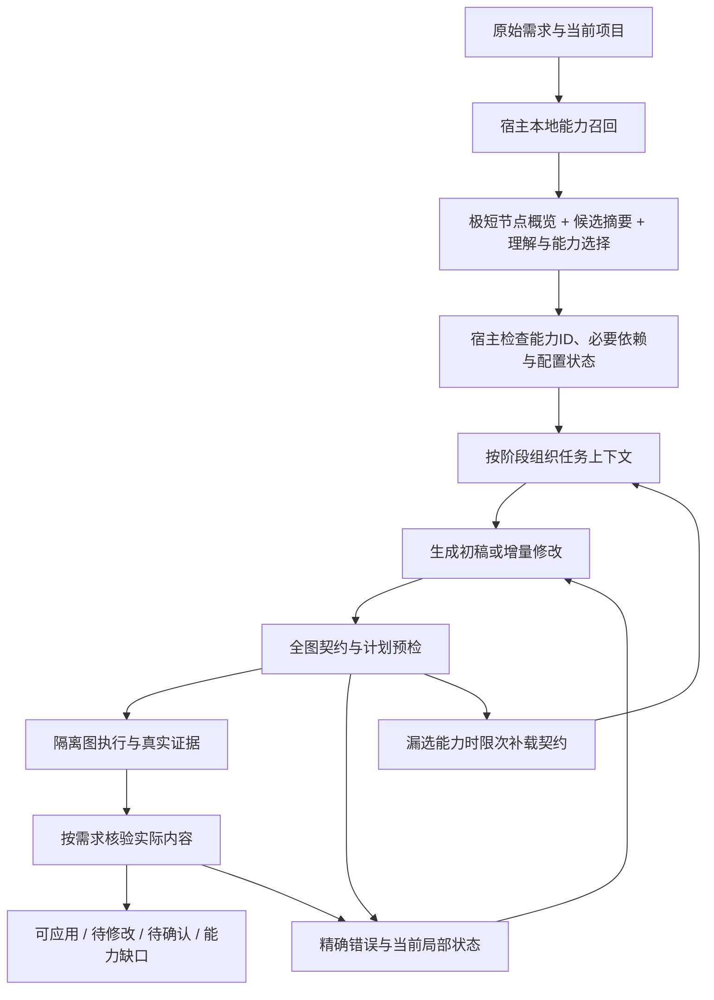

# 编排成本与可靠性整体优化方案

dev.111最新实现（2026-10-14）：按用户要求先理解并改写意图、附原始描述，再检索和选择能力；阈值与每意图Top-K替代字符预算。已接入明确 `understand → 检索 → select` 顺序，完整目录移至select，默认相对RRF门槛0.35/每意图普通32项。原文、否定/更正及强制引用保持，普通候选与目录安全保障分列；正常路径增加一次select但总8保持。原查询真实BGE候选60/60完整、246/248项集成通过（2既有Windows权限残余）。用户授权当前架构真实十例，独立静态复核7/10（70%）、图6/7、缺口/澄清1/3；意图/必要能力识别10/10仍未解决编辑范围与缺口交付、可信回执问题。42次调用/877,840输入＋输出token，未执行图，配对收益及总体可靠性未验证。新合同、兼容与验证范围以[dev.111需求](releases/2.8.0-dev.111/PRD.md)、[验收](releases/2.8.0-dev.111/ACCEPTANCE.md)、[逐例结果](releases/2.8.0-dev.111/TEST_CASES.md)为准，覆盖下文旧的6000字符/同次PlanningResult当前描述；原历史证据保留。

维护日期：2026-10-14。状态：设计与实施主依据；dev.109第一批M1/M2、dev.110混合索引及完整可见性、dev.111意图改写/独立选择与阈值/K已实现。当前真实十例静态编排未达质量目标；用户99.9%任务完整召回为准入目标，尚未总体/人工/执行验收；[当前口径与证据](releases/2.8.0-dev.111/ACCEPTANCE.md)。用途：任务能力发现、阶段上下文、提示词、增量修复与质量/成本的主依据。归属：dev.108形成设计，后续按各迭代验收登记。

主依据：[设计需求](releases/2.8.0-dev.108/PRD.md)、[历史真实批测及成本证据](releases/2.8.0-dev.108/ACCEPTANCE.md)、[实施需求](releases/2.8.0-dev.109/PRD.md)、[节点契约](NODE_CONTRACTS.md)、[目标架构](../architecture/03_Target_Architecture.md)、[ADR 0008](../adr/0008-target-architecture-and-device-access.md)。用户先要求制定方案，后明确“开始新起一个分支进行优化吧”；后者授权dev.109实施，覆盖上一轮仅定方案的范围。

**目标**：减少简单任务的无关输入、过量思考与整图返工，同时提高需求完整性、真实执行和正确缺口反馈的可靠性。

**架构**：在现有 FastAPI 单体、共享能力注册表和图执行器内优化，先覆盖当前真实使用的 bounded 引擎。Hermes 后续复用同一能力视图和上下文规则，保留固定 SDK 与 single/team 边界。采用 Python/Pydantic、现有 JSON 注册表与 TypeScript 图执行器，不增加外部检索服务。

执行者按里程碑采用 subagent-driven-development 或 executing-plans，每项先确认失败或离线基线，再完成实现与验证。设计原交付归dev.108；2026-10-13用户授权开始实施。第一批执行与证据见[dev.109任务](releases/2.8.0-dev.109/TASKS.md)及[验收](releases/2.8.0-dev.109/ACCEPTANCE.md)，当轮未创建提交，未完成项继续保留。

用户后续授权源码快照（2026-10-14）：本次开发提交保存dev.108–111相关实现、测试、原创夹具与文档，排除本机state/运行工件与纯EOL差异，不推送、发布或更新日常实例。独立静态编排7/10及M3–M5待修/待验收保持，实际范围与新复验见[dev.111提交登记](releases/2.8.0-dev.111/ACCEPTANCE.md#用户授权源码快照2026-10-14)。

## 1. 问题与取舍

当前需要同时解决输入规模、输出规模和返工次数。只调高 max_tokens 可以缓解截断，却没有降低实际成本。低思考强度在已做的一组 A/B 中也未体现节省，不能直接视为有效优化。

| 已核对事实 | 优化含义 |
| --- | --- |
| bounded 在理解和构图中提供全部 19 类节点目录，紧凑 JSON 33,966 字符；构图说明 10,157 字符、提交 schema 4,712 字符 | 能力目录、说明和 schema 都应按阶段提供；字符数不能当作精确 token 数 |
| 提供商工具是阶段提交函数 submit_scenario；构图时直接输出完整 WorkflowDraft | 能力选择属于宿主与模型的设计过程，当前没有可调用的能力查询循环 |
| 修复追加旧候选和错误，继续生成完整替换图与计划 | 增量 patch 和宿主状态视图可减少重复输入与输出 |
| CT-01 首构图输入 18,563，总输出 21,010，其中思考 18,167 | 需要分别衡量输入、可见结果与思考，不能只看图 JSON 大小 |
| CT-01 全程 7 次响应，累计输入 109,606，总输出 55,117，其中思考 41,516 | 重复调用与思考都是主要成本来源；此数据是失败样本，不代表平均成功成本 |
| 第一轮 32K 冻结六例 0 可应用；IN-02 澄清自动规则通过，其余五例失败 | 必须先校准语义与执行验收，不能用“成功率不低于原来的 0”验收优化 |

上表以[dev.108 验收](releases/2.8.0-dev.108/ACCEPTANCE.md)为准。累计输入含重发内容；未获得完整缓存与计费数据时，不折算成确定金额。当前 64K 构图/16K 审查 helper 仅是未验证、未载入的源码修改，不能作为已启用策略或优化成果。

建议采用渐进优化：先修正契约与证据，再精简阶段上下文、按需能力加载，最后改增量修复和调用策略。重建工作流 DSL、增加多智能体协商、引入向量数据库或自动切换廉价模型暂不进入第一批，现有证据还不足以支持这些成本更高的改造。

## 2. 全局约束与重点审查

- 原始用户目标、逐字约束来源、需求 ID、否定条件和真实/仿真边界保留；模型摘要不能覆盖原文。
- 不按生日、儿童关怀、关窗等场景关键词添加业务特判，不限制为固定节点数量或拓扑。
- 注册表是契约唯一来源；筛选生成上下文不删除能力、不替代全图校验，也不授予执行权限。
- 普通车控保持 actions 契约；已登记 HMI/MCP 的 JSON 例外按现有规则处理。
- 调用方验收计划完全锁定；AI 计划继续只允许现有受限修订。图或关键配置改变使旧执行/审查证据失效，试跑预算不重置。
- 保留真实图试跑和实际内容核验；正确的 needs_input/capability_gap 与可应用成果分别统计。
- 保持用户选择的服务商、模型及显式思考设置，不自动换模型或升级固定 SDK。
- 开发验证使用独立案例与隔离状态；不修改用户项目、日常 5175 副本/数据或共享模型环境。

重点审查五类输入：目录漏选与未知外部能力；长历史中的否定/更正；现有大图中的局部编辑；车辆动作范围和未执行却宣称成功；错误/截断后继续修复时的预算与证据版本。这些分别由 M2、M2、M3、M1/M4、M3/M4 的用例覆盖。

## 3. 目标链路

无返工的新建可执行任务，目标是 **3 次编排模型调用：理解并选择能力 → 构图 → 内容核验**。能力筛选并入理解，不额外增加一个规划模型。运行图中 LLM 节点的调用另行计数，但仍进入端到端成本。

已有需求、配置与能力事实有效的局部修改，可在 M3 后探索“patch → 核验”两次调用；事实过期或目标变化时重新理解。待确认/缺能力任务按现有草稿交付约定处理，避免明知不能运行仍进行重试或执行；不把快速失败记为低成本成功。

## 4. 任务相关能力筛选

### 4.1 两级能力视图

**发现视图**：从注册表生成所有可发现能力的短索引，保留 ID、用途、输入/输出形式、执行来源与必要限制。宿主先本地召回细粒度候选，理解阶段看到全部19类节点的极短概览和召回候选摘要，再返回需求与候选能力映射；不提供每个节点的全部字段、长说明和工具参数。低召回或索引不可用时扩大短索引，详见4.4，不将未命中当作无能力。

**构图视图**：只加载候选能力的完整必需契约，包括字段/枚举/范围、端口/数据绑定、动作或 MCP 参数、失败出口、执行与证据边界。不能为了压缩省略某个已选能力的必要字段。说明性重复文字可省，语义不能改。

能力粒度分开：节点类型、该类型支持的动作/工具、HMI control、已登记 MCP 的 server/tool。ID采用来源命名空间，例如 node:car_control、action:windows.close_all、hmi:display.mode、mcp:server_id/tool_name；只表示目录条目，不新增运行时动作。选择 tool 节点不代表已选全部 MCP；选择 car_control 不代表允许所有车控动作。第一版覆盖静态运行节点和已登记运行MCP，不接入尚未进入builder的 capability_library 导入资料库；未实现设备事实仍如实呈现，不将资料升级为执行能力。

节点类型裁剪本身还不够：当前 car_control 的描述、controlId 枚举和 hmi_controls 重复承载完整 HMI 目录。必须把公共基础字段与选中 operation/control 契约分开，从现有结构化 hmi_controls/动作契约导出片段，避免选一次车控仍加载全部座椅、显示、空调等定义。完整全图校验继续使用原目录；prompt片段声明是本次已加载范围，不是平台能力全集。详尽文本中的契约先核对到结构化来源再去重，不能靠字符串切割丢规则。

MCP 的发现索引不能仅来自静态节点 JSON。当前 mcp_runtime.catalog 会发现全部已配置服务，最多4路并发、每服务15秒，并携带完整inputSchema；第一版改为读取已授权绑定的非秘密元数据/已有描述生成短索引，对选中服务再 discover，参数 schema 只加载选中工具。没有可信用途描述时标 unknown，预算内发现后再选择，不能按 server/tool 名猜功能。发现失败归不可确定/连接失败，不证明服务未实现；发现调用和耗时计入整体期限及遥测，实际执行仍按现有权限检查。

### 4.2 选择与闭包规则

1. 理解阶段把每个 requirement_id 对应的能力 ID、需求用途与缺口结构化返回；没有业务场景关键词路由，语义选择使用同一次模型调用。
2. 宿主检查 ID 是否存在，以及 create_allowed、existing_readable、execution_source、configured、trial_authorized 五项独立事实。generatable不能代表设备接入或试跑权限；interaction等兼容可读节点与新建允许分别处理。不存在、缺权限或未配置分别记录，不能伪造工具或自动用仿真替代真实要求。
3. 补充**已有显式契约所要求的依赖**：绑定引用、必要上下游接口、运行/反馈数据契约。例如普通车控需actions协议、HMI需选中控件类型，但闭包只加载契约，不能自动插入LLM或固定节点拓扑。仅因输入输出类型相似，不把所有可连接节点都加入闭包；有多个可选实现时仍由需求选择。
4. 局部编辑保留现有节点类型与受影响的依赖，不限于一跳连线：包含 $ref、outputs模板、state写入来源、parent容器及计划断言引用。局部上下文可以缩小，宿主始终保有完整图并执行全图校验。
5. 不设固定 Top-K 门槛。记录候选、闭包增加项、来源及版本；低置信度作为诊断，不依据模型自报置信度自动宣告缺能力。

### 4.3 漏选恢复

第一版不改变 bounded 为开放工具循环。新增内部构图返回联合类型：原 WorkflowDraft，或 CapabilityNeed(kind=capability_need, requirement_ids, capability_ids, reason)。它不混进现有 extra=forbid 的 WorkflowDraft/ScenarioBrief；公开 brief/结果格式保持兼容。构图可请求补载已发现能力，或由未知能力/必要字段诊断识别漏选；不知道未召回能力的ID时允许capability_ids为空，由宿主按requirement_ids对应原始目标检索完整索引，不能要求模型猜ID。宿主验证 ID 后补载详细契约，重新构图。pending补载禁止试跑/应用，保留最近合法不可执行草稿；每请求最多一次能力补载，该响应计入三次构图尝试之一，后续构图继续扣剩余额度，不能免费追加第四次构图。已选依赖确有更多合法需求时，完整能力详情可作为该次保守回退，记为未达到成本目标。

所有模型报 missing 的项都由宿主对发现索引和实际接入状态复核，包括未主动提出补载的情况。只有依据完整相关能力事实确认不存在或未接入，才返回 capability_gap；缺权限/配置按实际原因标明。详情未加载、用途 unknown、选择未确定、发现失败或补载预算耗尽归 needs_changes（selection_incomplete 等诊断），不能转写为平台缺口。应补契约却误判“平台不支持”属于筛选失败。Hermes 后续将 oakegde_capabilities 增加向后兼容的 index/detail 视图；无参数旧行为保留，具体连续工具协议先单独验证。

### 4.4 内部召回工具选型（2026-10-13设计；dev.109实施）

用户追问内部能否使用召回工具进一步降低成本。建议第一版选 **SQLite FTS5 + BM25 本地检索**：宿主在规划调用之前执行，返回短候选，再由同一次规划模型理解/精排；不为查询或重排增加第二个LLM。SQLite提供BM25排名，分词与短词限制需按[官方FTS5文档](https://www.sqlite.org/fts5.html)实现和验证。dev.108本机只核对SQLite 3.45.3、ENABLE_FTS5编译支持；dev.109已实施内存索引、同ID/中文预切词和安全OR查询，并完成离线回归。其他环境与真实语义召回效果仍单独验收。

最小链路：`原始需求 → 本地检索候选 → 极短节点概览 + 候选摘要 → 现有规划模型选择 → 选中契约/必要依赖 → 构图与验证`。内部接口拟为 `search_capabilities(query, index_snapshot, required_refs) -> RecallResult`；query来自当前请求/已登记需求，required_refs来自当前项目真实引用，返回候选ID/摘要/来源/排名及索引版本，不能把BM25分数当能力有效概率。第一版是内部函数，不新增对外API，也不把bounded改为需要额外模型往返的查询工具循环。

- **检索语料**：按node/action/hmi/mcp分别索引规范ID、名称、用途、已有别名、输入/输出与来源状态；不直接索引重复的整份目录长说明。来源/权限状态随结果返回，未配置和不可试跑项不能被静默过滤为“无能力”。索引只从规范与安全绑定元数据重建，第一版放隔离内存，不写用户能力库SQLite或日常数据。
- **中文与ID处理**：索引与查询使用相同预切词，第一版评估中文双字片段为主、短词单字兜底与英文标识符切分，并保留完整ID精确匹配；不依赖默认unicode61完成中文词语理解。自然语言变成经转义引用的OR词项，避免默认多词AND和标点查询语法误伤，完整ID走精确旁路，不将原文直接当MATCH表达式。trigram全文检索不能匹配少于3个字符的子串，所以不能单靠它处理“关窗”等短词。业务否定与条件仍交给规划模型，检索命中某动作不等于允许执行该动作。
- **覆盖策略（dev.110用户最新要求）**：任务全部必需能力完整召回目标≥99.9%，缺一个即该任务失败，可用性先于裁剪。理解阶段始终提供全部已登记node/action/hmi/mcp的身份、用途、来源、当前权限事实、known/limits短目录；BM25＋embedding只决定优先候选和详情加载顺序，6000字符预算不隐藏目录身份。原五例七项均被排序后的预算裁掉，仅增Top-K不能提供保证。完整目录与注册快照集合相等是宿主无裁剪损失的确定性约束，不等于模型选择或编排达99.9%。已有引用/契约闭包保留；未知、未加载、权限或来源不足仍反馈selection_incomplete/needs_input，不假报平台缺口。理解上下文增大，实际token/费用另测。
- **混合检索（dev.110用户确认）**：原“暂不加embedding”属于第一批边界，已由用户“就BM25＋embedding吧，然后针对每个工具建立对应的索引”更新。每个工具/动作/控件/已绑定MCP身份维护独立索引记录，真实本地BGE与BM25排名融合，精确ID与已有项目引用保留；无需向量数据库。静态语义文档及模型版本决定向量缓存，动态权限/配置事实从当前注册表读取。依赖与模型隔离准备，不升级共享环境。以固定query→gold开发/留出测评比较原词法、修正词法与混合召回；不预先承诺准确率或节省比例，也不以召回分数证明能力存在或执行已授权。详见[dev.110需求](releases/2.8.0-dev.110/PRD.md)。
- **通过条件**：纯ID、中文短词、同义改写、否定条件、跨轮约束、未授权MCP、不可新建旧节点、强制漏选及空结果回退均有独立用例。离线候选召回与最终工作流正确率分列；检索候选变小但新增返工/目标遗漏时不能算优化通过。

## 5. 整体上下文精简

宿主维护原始请求、需求登记、完整项目、计划、配置版本和执行证据作为事实源。发给模型的是按阶段生成的确定性视图，避免模型反复生成“记忆摘要”并引入新的理解调用。当前 context() 截取末8条历史不能用作长期约束保证；理解阶段先提供本请求携带的全部用户原文与当前要求，由同一次理解明确登记约束及逐字来源、被更正关系，再在构图/修复阶段复用登记结果。已有 brief 只作带版本参考，宿主不能自行猜测旧约束失效；来源与更正有冲突就显式呈现。超长请求超过可承载上下文时返回上下文不足的实际诊断，不静默丢弃早期限制。

| 阶段 | 保留 | 去除重复内容 |
| --- | --- | --- |
| 理解/选择 | 原始请求、本请求全部用户原文与更正、带版本旧brief参考、当前项目目标/结构摘要、极短节点概览与召回候选摘要、真实配置状态 | 全字段目录、完整图、执行教程、全部工具参数 |
| 初次构图 | 锁定需求、已选完整契约、必要模型/MCP 配置、适用协议、计划能力与验收要求 | 未选目录、全部连接长列表、Hermes 专属工具说明、历史失败整串 |
| 修复/局部编辑 | 当前 revision、原始约束、目标节点及引用邻域、当前字段错误、必要计划约束、当前真实证据 | 多份旧候选、旧修复解释、每次重发完整图与完整目录 |
| 内容核验 | 原始约束和逐字来源、覆盖关系、实际输入/输出、关键回执与状态、证据 ID、适配器语义 | 构图教程、无关节点字段、全部目录、重复继承的 outputs 副本 |

上下文组织规则：

- 原文约束和最近更正优先，完整事实在宿主可定位。冲突须显式呈现，不用截取末尾 N 条消息抹掉早期限制。
- 大图提供总览 ID/类型/引用关系与修改邻域；节点业务数据只对受影响部分详细展开。发现跨邻域引用时扩展视图，不凭局部图认定全图有效。
- 已锁定计划由宿主持有，patch 不输出计划副本；模型需要原始测试输入/预期时提供受影响用例及不可变规则。首次计划形成仍看完整必要条件。
- 统计 system、schema、catalog、project、history、evidence、feedback 的字节/字符与可用 tokenizer 估算；提供商实际 usage 才是 token 验收依据，不能把估算标成实际消耗。
- 按任务需求扩展上下文；不得硬截必要契约、原文或证据来凑预算。超过成本目标仍可安全处理并报告超标原因，达到硬期限则停止。
- 独立阶段请求可以重建视图；**同一提供商工具连续回合所需的 message/tool_call_id/reasoning_content 不得为了精简丢弃**。DeepSeek 思考工具回合的回传要求见[官方说明](https://api-docs.deepseek.com/guides/thinking_mode/)。这些协议字段只在调用内存中处理，不落入诊断日志。

## 6. 提示词、输出与失败反馈

提示词按 **引擎 × 阶段 × 已选契约** 组合。bounded 只描述真正可用的提交协议，Hermes 描述其实际工具；schema 选择改为显式阶段参数，避免依赖 system 文本是否相等判断返回类型。

- 公共短规则只保留目标完整性、真实/仿真、缺口、锁定计划和不可冒称执行；每阶段只解释当前要交付的对象。
- 动态契约从注册表和现有执行协议导出，避免同时维护大段相互冲突的说明。用少量**协议级**示例解释 actions[].name/parameters、合法无动作、动作失败及窗口区域；不放完整场景答案模板。
- 明确 car_control.data.action 的节点分类值与 LLM 的 canonical 动作名分别属于不同接口。窗口 area=0/1/2/3/4 对应 all/fl/fr/rl/rr，其他已支持值沿既有契约保留；不把 area=3 当 rr。
- 保留各阶段严格 schema、业务字段/类型/权限校验。有效 JSON 不等于可执行，更不等于满足需求；结构化输出选项不能替代宿主检查。
- 模型负责业务逻辑、必要配置、内容和需求覆盖。可确定生成的边 ID、缺省布局和结构摘要逐步交给宿主；现有坐标不重排，原始设计说明不覆盖。宿主不代写用户业务答案或验收预期。
- 修复反馈提供稳定 code、节点/字段、真实 observed/expected、最小纠错方向和证据版本；不混入旧失败、无关教程或强制新增业务目标。相同候选/错误重复出现时停止无进展返工并保留原因。
- 审查区分行为错误、证据不足与适配器未支持，不凭规划扩写要求模型补出不存在的测试接口。原话决定必须满足的目标，补充验收仍需可执行。

## 7. 增量修复、执行与审查

优先复用 AuthoringSession 与 GraphPatch 的 revision、set_data/remove_data_keys、节点/边增删及事务规则。第一稿可保持完整 WorkflowDraft；M3 将 bounded 的后续修复改为 patch，不同时重写全图、计划与文档。

patch 必须基于当前 base_revision，遗漏字段保持；revision、事务包络、重复冲突操作、删除不存在对象等无效修改原子拒绝。完整连通性、字段绑定和业务语义继续由inspect全图检查；pending引用给出可定位诊断并阻止运行，不能要求每个合法中间patch都已构成最终完整图。需求覆盖仍按现有完整需求集合检查，不能随 patch 丢掉 missing。计划由既有 set_plan 单独管理，patch 不能修改锁定输入/预期；AI 计划的受限纠错继续留痕。即使只改变一个字段，也要重新执行受影响的全图检查，改图使既有试跑/核验失效。现有patch只提供事务修改与后续连接诊断，并未保证所有引用违法均原子拒绝，实施时不能误记现状。

执行与内容审查的通用补齐：

- 在锁定前，按实际试跑器能力准备初始条件与失败条件。已准备的 initial_windows/blocked_window RED 用于隔离试跑，不能作为工作流动作，也不作用于日常 HMI。
- 审查拿到真实 initial_vehicle、requested、actual、动作 receipt 和 source。当前 VehicleWorld 的 success 表示请求目标到位，不能证明未请求的窗也关闭；其他适配器按自己的完成语义判断。
- 复用 execution_review 的证据编号与真实原值校验机制，缩减副本同时保留足以判断每项原始目标的证据。bounded 的简单 ContentReview 与 Hermes 的 ExecutionReview 不直接混为同一外部 schema；适配后仍验证引用和覆盖。
- 无法执行的故障用例明确未验证，不能循环要求新增不存在的 case、改变锁定计划，或用“无法验证”放行已知行为遗漏。
- 执行证据复用先限同请求、同证据。现有 _fingerprint 仅包含nodes/edges，计划变动靠主动清理；计划哈希、模型/连接配置快照与适配器版本需由M1/M3补入证据身份，当前不能声称已完整覆盖。身份一致时沿既有规则限次重核验，同一证据只允许结构/协议错误的一次重核验（合计最多2次），passed/needs_changes不重抽；还受全请求审查/调用上限。读缓存不重放副作用；任何关键版本变化都不能复用旧 passed。不要仅凭一次模型“通过”缓存整个 workflow。

## 8. 调用策略与其他优化

### 8.1 推理与预算

将任务复杂度按实际需求判断：单次输入、条件/反馈、跨轮状态、外部工具、能力未知与修改范围；输入短不必然简单，车控需要正确性检查也不必然需要多角色协商。第一版把单次、已知能力任务作为成本目标组，包含条件和失败反馈，不规定固定拓扑。

用户未显式设置时，对同一模型比较默认/低强度/关闭思考的分阶段策略；理解、字段修复、证据核验与复杂规划分别测量。用户显式选择始终优先。现有一组 high/low 无收益，因此不预先宣称降强度能降成本。各提供商只发其已支持参数；DeepSeek 已知型号的选项与 usage 按[官方 API](https://api-docs.deepseek.com/api/create-chat-completion/)核对（2026-10-13），不向未知别名猜发控制字段。

保持bounded已有整体期限（已知DeepSeek 720秒，其他当前bounded提供商240秒）和最多三次构图/试跑；无返工目标3次，新增能力补载不得扩大这一尝试预算。设计bounded编排调用上限8次，含最多两次理解、三次构图与三次审查，**发请求前扣减**；失败、超时、截断、补载、协议纠错和核验重试都计数，提供商内部重发也计入对应阶段实际API次数。8次及全请求最多3审查是待实现限制，现有机制不能视为已经保证；额度耗尽保留最近合法不可应用草稿和当前原因，不恢复旧图passed证据。图内推理与外部工具保留各自原预算，单列但进入总成本。8次不是Hermes预算：其现有40次模型调用/720秒worker、780秒宿主预算继续按原规则，优化适配单独测量，不能直接套用bounded目标。

非法 JSON/已知提交协议失败按安全错误码进入剩余修复预算；网络、拒绝、缺配置/权限分别处理，不能无差别重试。截断参数不得拼补后执行；若继续，应精简本阶段或按已验证策略调整额度，并扣除同一剩余期限/调用额度。重复超标安全结束，禁止无限翻倍。32K/64K 是额度上限，最终选择由冻结 A/B 和真实质量决定；未测 helper 实施前须单列处理，不直接当新默认。

### 8.2 缓存、并发和运行时范围

- **稳定前缀**：公共规则、契约、schema 按稳定顺序放前，用户动态上下文放后；按注册表/提示词/schema/模型版本标识。记录缓存命中后再评估收益，不能为缓存把全量目录重新塞回去。缓存字段缺失为 unknown，不记 0；DeepSeek 的 prompt_cache_hit_tokens/miss_tokens 当前未完整映射，先补遥测。
- **本地确定性缓存**：短索引、选中 schema 和规则组合可按契约哈希缓存；不缓存密钥、不共享用户业务证据、不缓存实时权限/连接发现结果为长期可用。
- **独立检查并行**：本地契约检查与无副作用的配置状态读取可并行；改图、计划锁定、试跑和核验按依赖顺序执行。第一版不增加并行生成候选，因为会提高 token 和选择成本。
- **运行时动作精确范围**：目前下游存在 car_control 会开放多个动作名。后续按实际下游消费者的动作类型和参数约束求集合，再检查每条动作及固定区域，保留 auto 的既有能力；从契约导出而非从用户文本做关键词判断。先回归现有图，不以省 token 为理由改变动作语义。
- **提早停止**：确定性契约错误先定位再调用修复；blocking questions/真实能力缺失保留合法设计草稿并停止不必要运行。取消立即传播至上游与子进程，不能在用户取消后继续消耗调用。

## 9. 实施里程碑与文件边界

每个里程碑都是独立可验收的改动，先补有回归价值的测试，再实现并做针对性检查。不得把全部改造一次切换。第一批优先 M1 与 M2；M3–M4 依据它们的实测瓶颈推进。

| 阶段 | 输出 | 实现与测试边界 | 通过条件 |
| --- | --- | --- | --- |
| M0 基线与分支 | 干净的范围清单、保护数据 hash、独立优化分支、冻结对照标识 | Git 状态；dev.108 需求/任务/验收；未测 helper/RED 清单 | 完整区分 HEAD、当前修改、运行副本；不丢已有修复 |
| M1 契约/证据/计量 | 动作协议一致、可执行试验条件、完整安全成本记录 | builder、provider、execution_review、执行 schema/TS runner、日志与 batch | 弱初始条件与范围错误被发现；协议失败使用原预算；用量分层准确 |
| M2 能力与上下文 | 短索引、选择映射、必要依赖、阶段视图、引擎专属提示 | 注册表服务、builder；拟新增 capability_selection.py / authoring_context.py；独立选择/上下文测试 | 离线覆盖不漏必需能力/约束；正确缺口与漏选恢复；上下文实际缩小 |
| M3 增量修复 | bounded 复用 GraphPatch、当前状态反馈、语义一致的全图检查 | authoring_session、builder、diagnostics；patch/恢复/局部修改测试 | 用户字段/布局/coverage/计划保持；旧 revision 拒绝；证据失效与预算不重置 |
| M4 模型与运行策略 | 分阶段思考实验、缓存遥测、动作范围、无进展停止、Hermes 兼容 | model_reasoning/providers、GraphEngine、Hermes adapter；取消与协议测试 | 显式设置不变；完整工具协议；未获收益的策略不启用 |
| M5 冻结质量/成本验收 | 成对真实报告、保持原图的独立回放、可回退启用 | batch/benchmark runner、原套件及独立留出用例、开发者文档 | 质量门槛先过，再达成本目标；日常版本更新独立决定 |

具体任务：

- [x] **M0**：实施时新建建议分支 `codex/orchestration-optimization`，承接当前相关修改。若需隔离 worktree，先取得明确可恢复基线并排除密钥/用户数据，不能仅从 HEAD 创建空 worktree 丢掉 dev.108 修改。dev.109已原地创建分支；没有提交，保护哈希不是Git快照。
- [x] **M1-A**：修改 `model_providers.py`、`orchestration_logging.py`、后端 `scenario_execution.py` 与 `scripts/test_workflow_batch.py`，按请求启动/完成增量记录阶段/尝试、耗时、输入/输出/思考/缓存、结束原因、上下文组件尺寸及策略版本；用安全call_id去重，不等最终result才回放统计。图内 _cloud_inference 也传播数值usage；失败/取消前已完成调用不能丢失，未返回usage的失败记未知而非0。扩展提供商/日志/执行/batch测试，断言多阶段后致命失败仍保留前面usage，调用次数发起前扣减，且不输出正文、密钥、原始推理或上游错误。
- [x] **M1-B**：在 `node_capabilities.json`、`flow_contract.py`、`scenario_builder.py` 补准确协议，复用 `execution_review.py` 的证据机制；完成现有 action_authoring_guidance / builder_review_evidence / vehicle_action_authoring_contract 回归，并验证非法 JSON 等安全码只消耗原三轮预算。
- [x] **M1-C**：对 `execution_schema.py`、后端 `scenario_execution.py`、TS `testPlanPreflight.ts`/`scenarioExecution.ts` 完成 initial_windows/blocked_window 条件。实施时已准备 tests 不视为完成：四窗完整键/数值有限且 0–100、故障键白名单、实际初态与用例隔离、成功和失败回执、调用方锁定均要通过。
- [x] **M2-A**：已新增 `backend/app/services/capability_selection.py`，定义 `capability_index(catalog, connection_snapshot) -> list[CapabilitySummary]`；`resolve_selection(selection, catalog, project, connection_snapshot) -> CapabilityView`，并以同一模块内的 `search_capabilities(query, index_snapshot, required_refs) -> RecallResult` 实现FTS5/BM25内存召回，暂不单独增加检索框架/模块。Summary 提供 ID/node_type/operation/用途/输入输出/来源/限制/known状态；CapabilitySelection 提供 requirement_id→capability_ids 与待查项；View 提供选中基础/operation契约、必需依赖、五项状态事实与哈希。规划内部返回 PlanningResult(brief, selection)，公开 ScenarioBrief 不改为含查询字段。修改既有 mcp_runtime 按选中 server 发现且保留旧 catalog 接口；连接快照由既有代码读取，不在解析函数中发外部请求。复用 node_data_schema.patch_data_schema(catalog=...)，但处理其enum_source避免重新展开全部HMI控件。测试4.4检索用例、候选边界外补载与所选control详情、旧不可新建节点可读/保持、未知MCP不假报gap、发现超时和未授权工具禁止执行。
- [x] **M2-B**：已新增 `backend/app/services/authoring_context.py`，定义 `build_stage_context(stage, request, brief, capability_view, session_state, diagnostics) -> dict`；无模型调用、无文件写入，生成可复现视图。builder 显式传阶段/schema并解析 WorkflowDraft/CapabilityNeed 联合返回。测试历史第9条之外的约束与显式更正、长历史、相似但不可用能力、跨图引用、漏选补载、直接报missing但详情未加载、预算耗尽不假报gap，以及token估算标识。
- [ ] **M3**：复用现有 `GraphPatch`/`AuthoringSession.patch`/`set_plan`，后续 repair 接受 patch，宿主组装最终响应。补 stale revision、事务失败不部分修改、合法中间patch与最终inspect、未提交字段/坐标保持、coverage完整、严格JSON锁定、改图失效、计划/配置/适配器版本改变不复用证据、无进展终止与合法草稿保护回归；不新造第二套patch协议。无进展重复反馈的停止可在M1先实现，不等待思考策略实验。
- [ ] **M4**：先完善显式/隐式设置与工具协议回归，再在冻结实测中选择分阶段策略。运行时动作范围先用确定性图验证，不同时改变生成提示和执行规则后混算因果。Hermes 的能力 detail 视图按兼容扩展验证，固定 SDK 不改。
- [ ] **M5**：分别冻结代码/提示词/schema/目录/套件/运行配置，接入独立图回放、预先固定oracle与人工内容评审，执行下节分批实验。当前HTTP批测的独立runtime=not_run、manual=pending不能产生完整accepted，需扩展batch/benchmark汇总与证据关联，不把生成内runtime_verified代替独立验收。同步 NODE_CONTRACTS、CONCEPTS、CONFIGURATION、TESTING、既有专题和迭代验收；功能实现后才将本方案任务勾选完成。

dev.109已创建并调用capability_selection.py与authoring_context.py；M3/M4/M5仍按表中边界后续实施。现有源码落点：[builder](../../backend/app/services/scenario_builder.py)、[session](../../backend/app/services/authoring_session.py)、[registry](../../backend/app/services/node_capability_service.py)、[review](../../backend/app/services/execution_review.py)、[provider](../../backend/app/services/model_providers.py)、[runtime](../../studio/src/utils/GraphEngine.ts)。新增文件仅在实际被调用时创建，避免空框架。

## 10. 验证设计与量化目标

### 10.1 质量门槛

原六例与既有更广套件保留；另加独立留出变体，覆盖措辞变化、相反条件、区域变化、状态非零、故障回执、未配置/无权限、额外/漏选能力、跨轮约束、局部编辑和工具内容中的伪指令。留出用例预期由人或确定性 oracle 预先固定，不能把同一生成模型的自评视为独立质量。

自动检查至少包括：所有需求 coverage 与可验证引用完整；Python/TS 契约一致；动作范围/回执正确；锁定计划不变；试跑与核验指纹一致；缺口/澄清不得 can_apply；错误路径不越过预算。CT-01 非零四窗从开启到关闭、失败不能宣称成功；CT-02 rr 动作且其他窗保持、否定输入不动作，必须由实际状态验证，不能只看关键词。完整后端的12项已知残余与本轮新增回归分列，新失败必须处理，不能跳过或削弱断言取得全绿。

质量指标分母先固定：可执行任务用可应用率及独立语义验收率；缺口/澄清用正确处置率；所有任务用错误放行率、目标遗漏率与失败分类。首次正式目标：本次独立确定性回归100%通过；**预登记可执行组独立验收成功率至少90%，预登记缺口/澄清组正确处置率至少90%，分别达标**，不可用大量正确gap掩盖可执行组全失败。超时、SSE错误、回放未执行与人工pending留在分母且未通过。原六例为4可执行（CT-01、CT-02、BT-02、CR-01）+1缺口（CT-03）+1澄清（IN-02）；每侧三次重复共18请求，可执行分母12、处置分母6。更广/留出组分别列样本数；危险/未验证错误放行在样本中为0。样本0次不等于证明未来错误概率为0；不足样本时只报告观察结果。

### 10.2 成本目标（待实测校准）

以下是设计目标，不是现状承诺，也不是丢弃必要上下文的硬限制。实验前登记简单任务组：新建、单次输入、已知能力、用户未指定高思考；复杂多轮、真实能力未知、长历史、大图修改及显式高思考分别登记。简单组即使失败、返工或超时也留在该组，不能事后剔除高消耗请求。3次与正常流程输入/输出是无返工路径目标；组内60%/延迟/每成功成果成本包括全部失败与返工。

| 指标 | 第一阶段设计目标 |
| --- | --- |
| 正常编排模型调用 | 3 次，含内容核验；图内模型调用另计并计入总成本 |
| 首构图实际输入 | ≤6,000 token（CT-01 原样本 18,563） |
| 正常流程累计编排输入 | ≤18,000 token |
| 正常流程累计编排输出 | ≤8,000 token，包含提供商报告的思考部分 |
| 简单组端到端 token 消耗 | 预先固定同模型/用户设置/用例，逐对算 1−优化token/基线token，降幅中位数≥60%，同时满足质量门槛 |
| 延迟 | 成对对照报告中位/p95与超时率；首批期望中位降低 40%，p95 样本不足不作结论 |
| 返工 | 独立报告首次可用率、repair 次数、schema/契约/内容/配置各类失败，不能靠删审查达标 |

报告同时包含编排与生成内试跑调用，失败请求也计入消耗。每个成功成果成本 = 该组所有成功及失败生成请求的总成本 / 独立验收成功数量；成功数为0时记未定义，不能写0。独立回放/评审的额外验证消耗另列，并计入整批付费实验预算，避免与产品生成成本混算。usage不完整的请求保留unknown与已知下限，不能剔除后宣告全组60%达标；currency只有对应模型当日价格与真实缓存字段时计算，价格版本写入报告。reasoning若已包含在completion中，不重复计费。

### 10.3 实验顺序与预算控制

1. **离线优先**：用已有候选/安全元数据和确定性夹具检查 context 尺寸、选中能力、patch 与执行语义；没有原始响应正文的样本不伪造“完整模型重放”。局部协议测试用替身，分别标识模拟/真实。
2. **单变量探针**：在同一代码/模型/思考设置下先比较阶段上下文，再能力筛选，再增量修复；降低思考强度单独 A/B，不把模型或执行条件变化当上下文收益。每次最多选两条代表用例，先看质量及实际用量再扩大。
3. **原六例成对验证**：基线与优化各重复 3 次，为未来实验上限 36 次 HTTP 编排请求；每请求可能包含多次模型与图内调用，因此不能称 36 次 API 调用。先执行每组 1 次检查，再在没有新阻断时续跑。现有批次只作历史参照，不冒充同配置的配对基线。
4. **更广覆盖与留出**：原套件全量一轮和独立留出各一轮分开报告。付费实验开始前列出案例数、最多请求/模型调用、总期限与所选阶段额度；结合探针用量确定总 token/金额上限，未确定上限不启动扩大批次。达到上限停止并保存已得证据。
5. **验收后启用**：记录优化策略版本，开发环境先启用；旧路径保留用于明确回退与对照。回退不切模型、不恢复旧项目数据。固定日常版通过 prepare/保存完成后的独立更新流程处理，不能自动同步开发副本。

实施与后续验收入口：在 backend 目录用 host-lite Python 的 `-m unittest tests.<模块>` 执行相关测试，Windows 子进程统一 UTF-8/SystemRoot；新模块合入后才执行对应测试。前端从 studio 运行 `node scripts/test-trial-window-conditions.mjs`、`node scripts/test-scenario-execution.mjs` 与必要的 `npm run build`。批测入口为 `scripts/test_workflow_batch.py`；当前尚缺此方案的策略/总消耗预算开关，须完成遥测与预算控制后再用于扩大实验。

## 11. 当前交付与未决实验

dev.109在codex/orchestration-optimization实施第一批M1/M2，原地承接未提交dev.108工作区。动作/初态/回执、增量安全计量、内存召回与阶段视图已实现；原RED按真实本地执行与模型替身验证，未测64K改动恢复冻结32K/8K，不作为优化成果。随后[原创十例实测](releases/2.8.0-dev.109/TEST_CASES.md)在修复工具Schema对象根和SSE运行ID后独立冻结：可应用且回放4/7、正确澄清1/3，未达90%，人工待复核。JSON/宿主编辑能力误判、核验截断及最终证据字段残余继续待修，缺口两例受实验预算拒绝影响；正式625,392输入+输出token，没有同配置配对基线。M3/M4及M5真实对照仍待验收；修前及正式失败样本分别保留。实际范围、数字与限制以[dev.109验收](releases/2.8.0-dev.109/ACCEPTANCE.md)为准。

待实验决定的是具体阶段思考默认、最合适的输出上限、稳定前缀的真实命中收益，以及 Hermes 连续工具协议与局部视图兼容性。它们不阻塞先做契约、能力视图与离线测试；不能提前填入已节省比例、真实成功率或发布日期。
